# PFO 2 - Sistema de Gestión de Tareas

Proyecto realizado con **Python, Flask y SQLite**.

Permite registrar usuarios, iniciar sesión y acceder a una página de bienvenida mediante el endpoint `/tareas`. Las contraseñas se almacenan utilizando hash y los usuarios quedan guardados de forma persistente en SQLite.

## Ejecución del proyecto

Primero instalar las dependencias:

```powershell
py -m pip install flask requests
```

Luego ejecutar el servidor:

```powershell
py servidor.py
```

El servidor queda disponible en:

```text
http://localhost:5000
```

En otra terminal ejecutar el cliente:

```powershell
py cliente.py
```

El menú permite:

```text
1. Registrar usuario
2. Iniciar sesión
3. Salir
```

Al iniciar sesión correctamente, el cliente accede automáticamente a:

```text
GET /tareas
```

También se puede probar desde el navegador ingresando a:

```text
http://localhost:5000/login
```

Luego de iniciar sesión correctamente se redirige a:

```text
http://localhost:5000/tareas
```

donde se muestra el HTML de bienvenida.

## Endpoints

| Método | Ruta | Función |
|---|---|---|
| POST | `/registro` | Registra un usuario. |
| POST | `/login` | Verifica usuario y contraseña. |
| GET | `/tareas` | Muestra el HTML de bienvenida. |
| GET | `/logout` | Cierra la sesión del navegador. |

## Capturas de las pruebas

### Servidor funcionando

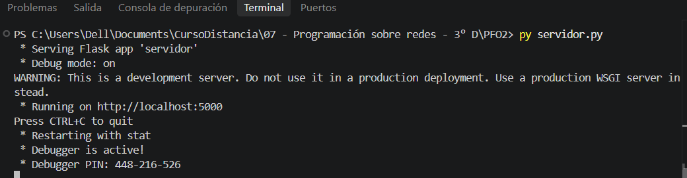

### Cliente de consola

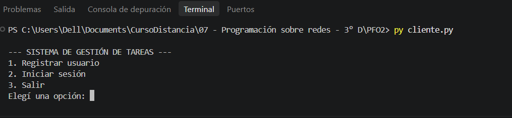

### Registro de usuario

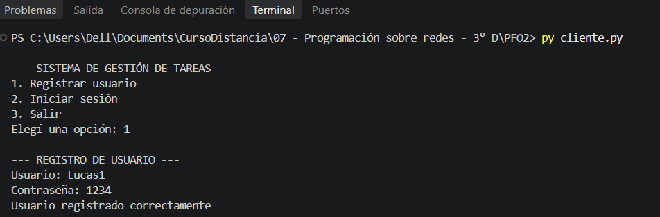

### Contraseña almacenada como hash

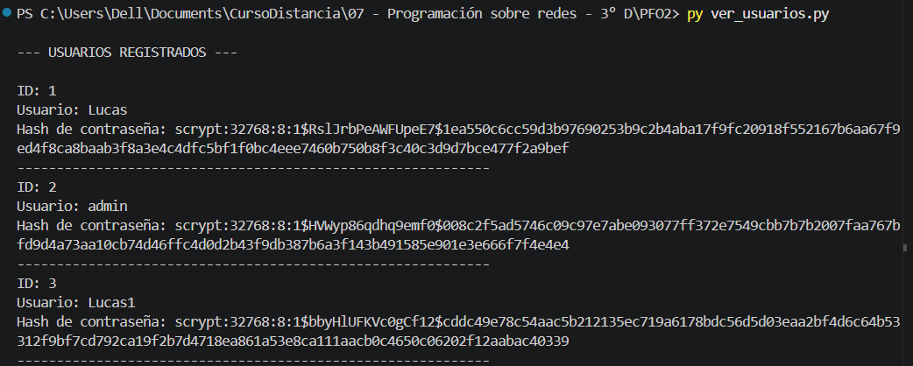

### Inicio de sesión correcto

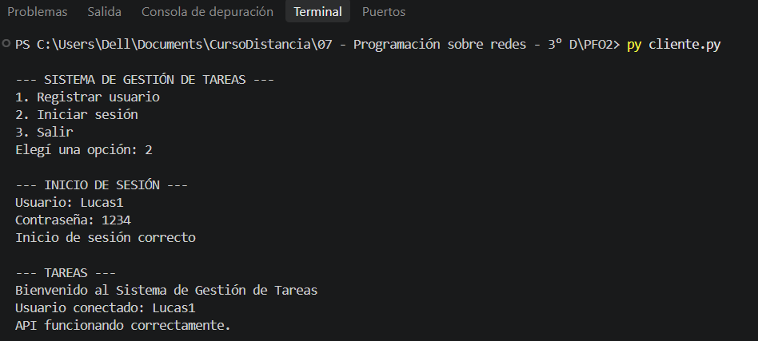

### Inicio de sesión incorrecto

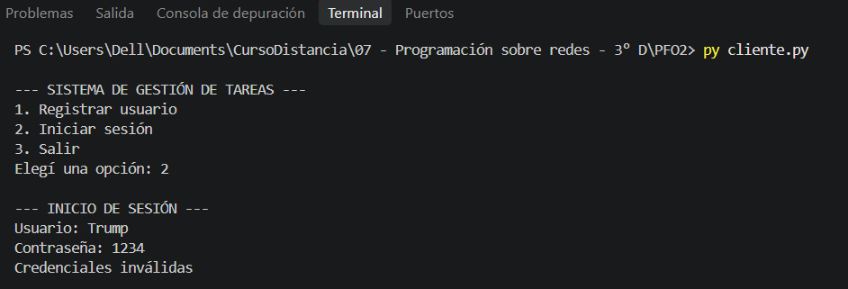

### Salir del cliente

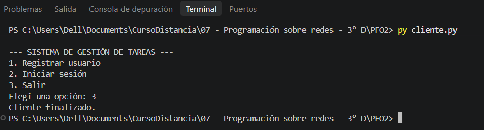

### Inicio de sesión desde el navegador

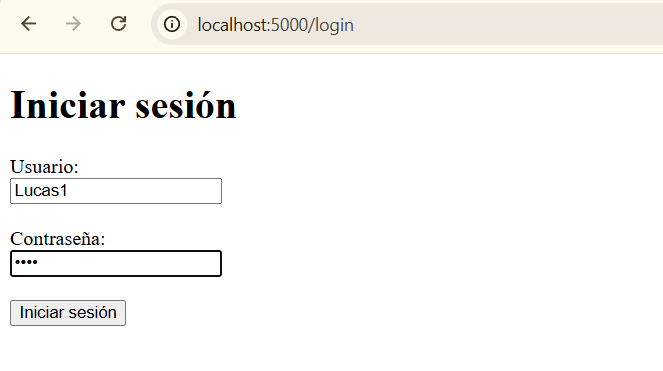

### Página de bienvenida

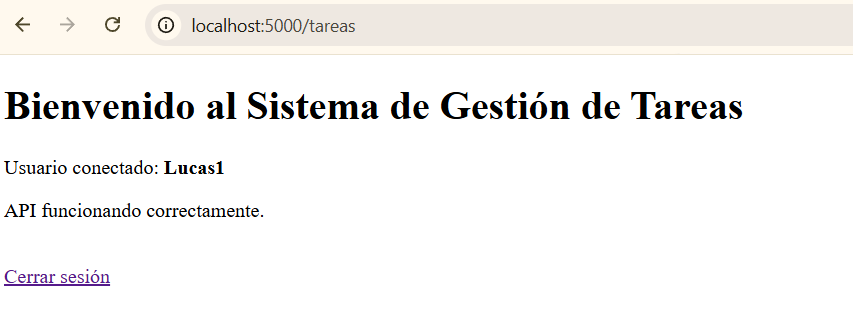

### Cierre de sesión

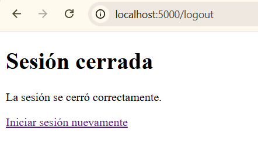

### Inicio de sesión web incorrecto

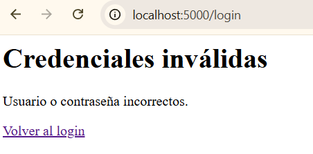

## Respuestas conceptuales

### ¿Por qué hashear contraseñas?

Hashear las contraseñas permite evitar que se guarden directamente en texto plano.

De esta forma, si alguien accediera a la base de datos, no podría ver inmediatamente las contraseñas originales de los usuarios.

Durante el inicio de sesión se compara la contraseña ingresada con el hash almacenado, sin necesidad de guardar la contraseña real.

### Ventajas de usar SQLite en este proyecto

SQLite es una buena opción para este proyecto porque es simple, no necesita configurar un servidor de base de datos aparte y se integra directamente con Python.

Además, guarda toda la información en un único archivo y permite que los usuarios registrados sigan almacenados aunque se cierre y vuelva a ejecutar el servidor.

## Repositorio

El código fuente, las capturas y la documentación del proyecto se encuentran en GitHub.

**Repositorio:**

```text
https://github.com/Caligarum/PFO2-Redes.git
```

